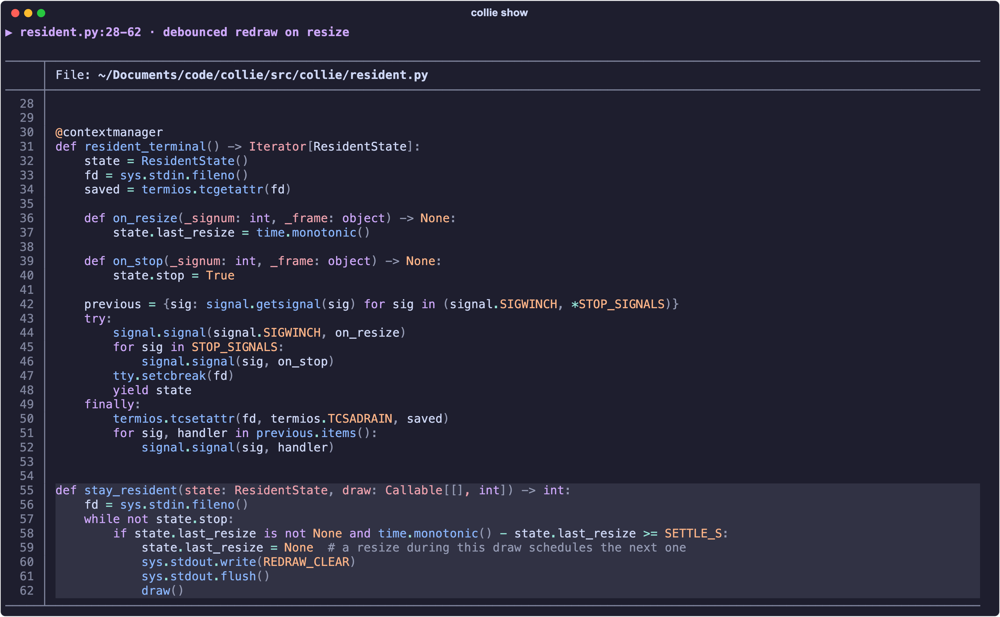
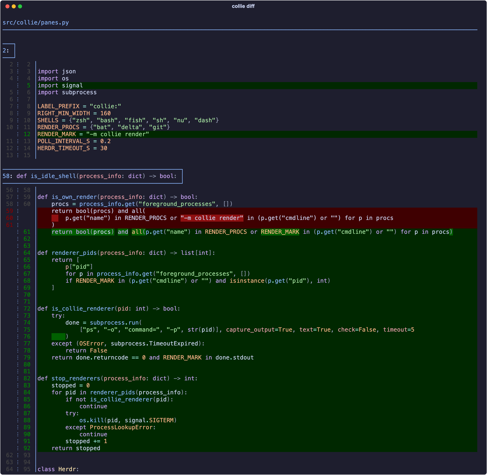

# collie

**Your agent shows you the code instead of describing it.**

When an agent running in [Herdr](https://herdr.dev) explains a function or a change, collie opens a
pane beside it and renders the exact lines, colored with [bat](https://github.com/sharkdp/bat)
(files) or [delta](https://github.com/dandavison/delta) (diffs) in Catppuccin Mocha. The agent
cites `resident.py:55-62`; you see `resident.py:55-62`. Named for the dog that works the herd.



<p align="center"><em><code>collie show src/collie/resident.py:28-62@55-62 --note "debounced redraw on resize"</code></em></p>



<p align="center"><em><code>collie diff 1230ef1 --path src/collie/panes.py</code></em></p>

## What it does

- **One pane, reused.** collie splits a code pane next to the agent once and redraws into it on every call; it never opens a second one.
- **Excerpts, not files.** Up to 5 ranges per call, across files, with highlighted lines and a one-line note.
- **Diffs.** Uncommitted changes, or any revision against the working tree, optionally limited to one path.
- **Polite.** If you are typing in the code pane, collie leaves it alone (exit 4) instead of sending keys into your shell.
- **Resize-aware.** The pane redraws at the new width when you resize it; any key returns your shell.

## Install

Prerequisites: [uv](https://docs.astral.sh/uv/), Python 3.11+, and `brew install bat git-delta` (macOS) or the distro packages (Linux).

```bash
uv tool install git+https://github.com/KnobleChipmunk/collie
collie setup --dry-run   # preview: skill link, AGENTS.md block, SessionStart hook
collie setup
```

`collie setup` is what teaches your agents to use collie: it links the skill, adds a rule to
`AGENTS.md`, and adds a SessionStart hook. It is idempotent and writes
`settings.json.bak.<timestamp>` before changing `~/.claude/settings.json`.

### As a Herdr plugin

```bash
herdr plugin install KnobleChipmunk/collie   # build step runs `uv tool install --force .`
collie setup                                 # still required: the plugin cannot wire up your agents
```

Herdr does not install the prerequisites above. The plugin adds one action, `collie.close`
(close the code pane beside the focused pane). Bind it in `config.toml`:

```toml
[[keys.command]]
key = "prefix+alt+c"
type = "plugin_action"
command = "collie.close"
description = "close collie pane"
```

## Use

Agents call these for you once `collie setup` has run. You can call them yourself from any Herdr pane:

```bash
collie show path/to/file.py:36-64@41-47 --note "retry loop"   # lines 36-64, highlight 41-47
collie show a.py:10-20 b.py:5-9                                # up to 5 excerpts in one call
collie show path/to/file.py --match "def _batch" --context 8   # find lines by text
collie diff                                                    # uncommitted changes
collie diff HEAD~1 --path src/a.py                             # a revision against the working tree
collie close                                                   # close an idle code pane
```

| Exit | Meaning |
|---|---|
| 0 | shown |
| 2 | bad input: missing file, bad range, unknown revision, bat or delta not installed |
| 3 | not inside Herdr |
| 4 | the code pane is busy (you are using it); nothing was sent |

## Configure

| Variable | Effect |
|---|---|
| `COLLIE=off` | disable collie (useful for builder and reviewer panes) |
| `COLLIE_THEME` | bat/delta theme; set it in your shell profile, because the code pane runs its own shell |
| `COLLIE_RESIDENT=off` | draw once and return to the shell, instead of staying to redraw on resize |

## Known limitations

- A path with `@` in any parent directory exits 2 (the pane could not parse it back).
- Each render adds one line to the code pane shell's history.

## Development

```bash
uv sync
uv run pytest
```

The spec lives in `openspec/changes/add-collie/`. The screenshots are real pane output: see
[`docs/images/README.md`](docs/images/README.md) to regenerate them.
